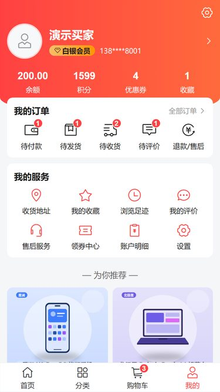
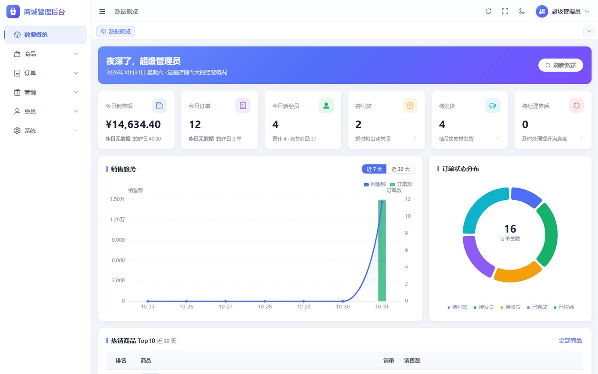
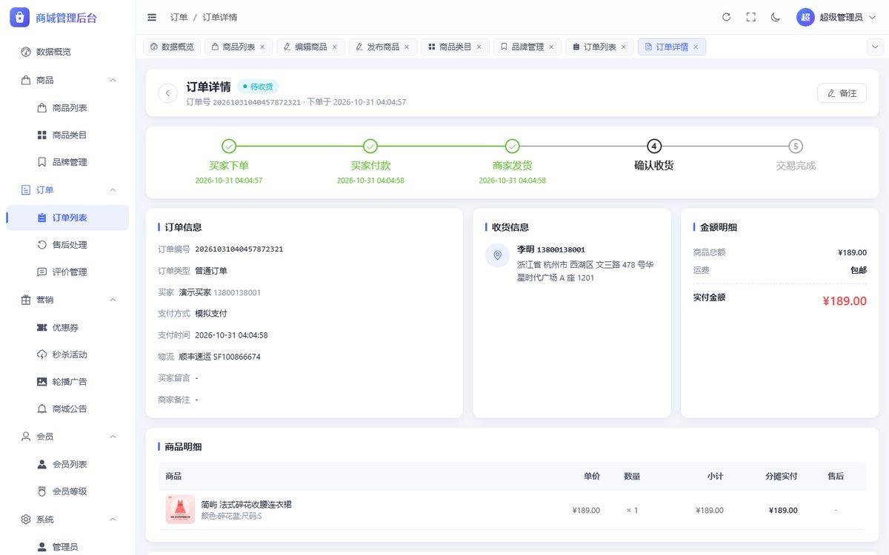

# 优选商城 platform-cloud

> 开箱即用的单店铺电商系统：移动商城 + 管理后台 + 服务端，一条命令部署到任意装有 Docker 的服务器。

     

| 移动商城 | | | 管理后台 |
|---|---|---|---|
|  |  |  |   |

## 功能特性

| 模块 | 买家（移动商城） | 商家（管理后台） |
|---|---|---|
| 商品 | 首页导购、类目、搜索排序、商品详情、多规格选择 | 两级类目、品牌、多规格 SKU 自动组合、富文本详情、批量上下架 |
| 交易 | 购物车、结算（会员折扣 + 优惠券 + 运费自动计算）、余额支付、订单跟踪 | 订单筛选与状态统计、发货、改价、备注、取消、操作日志 |
| 售后 | 仅退款 / 退货退款、上传凭证、填写退货物流 | 审核、确认收货退款，原路退回余额并回补库存 |
| 评价 | 星级、图文、匿名评价，好评率与筛选 | 回复、显示隐藏 |
| 营销 | 领券中心、限时秒杀倒计时 | 满减 / 折扣 / 无门槛券（按全场、类目、商品）、秒杀活动、轮播、公告 |
| 会员 | 验证码 / 密码登录、地址、收藏、足迹、余额积分明细、等级 | 会员管理、调账、等级与折扣 |
| 运营 | – | 数据概览（销售趋势、订单分布、热销 Top10）、系统参数（运费、超时时间、积分规则） |
| 系统 | – | 管理员、角色与按钮级权限、菜单、字典、操作日志、登录日志、浅色 / 深色主题 |

自动化：未支付订单超时关闭、发货后自动确认收货、优惠券过期处理，均为每分钟执行的分布式锁定时任务。

## 快速开始

**部署到服务器**（需要 Docker；开发机需要 JDK 17、Node 18+、Git Bash）：

```bash
bash deploy/mall/deploy.sh <ssh 主机>
```

脚本依次完成：单元测试 → 构建 → 打包 → 上传 → 启动 → 全链路冒烟测试。完成后访问：

| 地址 | 说明 |
|---|---|
| `http://<主机>:8090/` | 移动商城（手机或浏览器打开） |
| `http://<主机>:8090/console/` | 管理后台，初始账号 `admin` / `admin123`（登录后请立即修改） |
| `http://<主机>:8090/doc.html` | 接口文档 |

首次部署会自动生成随机数据库、Redis、JWT 密钥，并导入 8 个类目、37 个商品的演示数据。部署细节、运维命令与上线检查清单见 [deploy/mall/README.md](deploy/mall/README.md)。

**本地开发**：

```bash
# 1. 准备 MySQL 8（建库 mall）与 Redis 7，连接信息用环境变量传入，表结构与演示数据由 Flyway 自动创建
export MYSQL_HOST=127.0.0.1 MYSQL_USER=mall MYSQL_PASSWORD=*** REDIS_HOST=127.0.0.1 REDIS_PASSWORD=***
./mvnw -pl mall-server -am package -DskipTests && java -jar mall-server/target/mall-server.jar   # 服务端 :8081

# 2. 前端：默认代理到已部署环境；直连本地服务端加 VITE_PROXY_TARGET=http://localhost:8081 VITE_PROXY_DIRECT=1
cd web/mall-admin && npm install && npm run dev   # 后台 http://localhost:5173/console/
cd web/mall-h5 && npm install && npm run dev      # 商城 http://localhost:5174/
```

演示图片在 `deploy/mall/seed/uploads`，本地运行时复制到 `./data/uploads` 即可显示。

## 工作原理

```
 浏览器 ──▶ Nginx :8090 ──┬── /            移动商城静态文件
                          ├── /console/    管理后台静态文件
                          ├── /uploads/    图片（直接读磁盘）
                          └── /api/ ──▶ mall-server :8081 ──▶ MySQL 8 / Redis 7
```

服务端是**模块化单体**：按领域分包，领域之间只通过 `*/api/*Api` 接口调用，不共享 Mapper。单机即可承载中小店铺，日后可按领域整体拆为微服务（`service/`、`infra/` 目录保留了 Nacos / Gateway / RocketMQ / ES 的拆分实验）。

| 领域 | 职责 |
|---|---|
| system | 管理员、角色权限、菜单、字典、参数、日志、文件上传 |
| member | 会员注册登录、资料、地址、收藏足迹、余额积分成长值 |
| goods | 类目、品牌、商品 SPU/SKU、库存扣减、首页聚合 |
| marketing | 优惠券、秒杀（Redis Lua 原子扣减）、轮播、公告 |
| trade | 购物车、订单状态机、支付渠道、售后、评价、定时任务 |
| stats | 后台数据概览 |

关键设计：库存与余额用条件更新防超卖、超扣；下单与支付带幂等令牌；订单状态变更统一经状态机并记录日志；价格计算为纯函数并有完整单测。

## 安全

- 密码 BCrypt；JWT 密钥只从环境变量注入；后台登录失败 5 次锁定 15 分钟。
- 管理端与商城端令牌按角色隔离；后台按钮级权限 `@PreAuthorize("@ss.has('...')")`。
- 会员数据查询强制带当前用户 ID，防越权；手机号列表脱敏。
- 上传文件校验扩展名白名单与大小，随机文件名，防目录穿越；SQL 全部参数化。
- 演示开关：`MALL_SMS_DEV_MODE`（验证码回显）与 `MALL_PAY_MOCK_ENABLED`（模拟支付）**上线前必须关闭**，见部署文档检查清单。

## 项目结构

```
platform-cloud/
├── mall-server/          商城服务端（Spring Boot 3.3 + MyBatis-Plus + Flyway）
├── web/mall-admin/       管理后台（Vue 3 + TypeScript + Element Plus + ECharts）
├── web/mall-h5/          移动商城（Vue 3 + TypeScript + Vant 4）
├── starter/              公共 starter：统一响应、异常、JWT、MyBatis、幂等、多级缓存
├── deploy/mall/          Docker Compose 部署、Nginx 配置、发布脚本、演示图片
├── scripts/              冒烟测试、演示图片生成
├── docs/                 开发规范、接口契约、截图
└── service/ infra/ bootstrap-app/   微服务演进实验（不参与商城部署）
```

## 开发

- 开发规范：[docs/DEVELOPMENT.md](docs/DEVELOPMENT.md)；接口契约：[docs/mall/api.md](docs/mall/api.md)（改接口先改契约）。
- 测试：`./mvnw -pl mall-server -am test`（295 个单元测试）；部署后 `python scripts/smoke_test.py http://<主机>:8090`（11 项全链路检查）。
- 表结构只通过 Flyway 迁移变更：`mall-server/src/main/resources/db/migration`。

## 路线图

- [ ] 接入微信支付 / 支付宝（`PayChannel` 已预留，回调路径已放行）
- [ ] 接入阿里云 / 腾讯云短信（实现 `SmsSender` 即可替换）
- [ ] 微信小程序端（复用 `/app/**` 接口）
- [ ] 对象存储（实现 `FileStorage` 即可切换到 OSS / COS / MinIO）
- [ ] 拼团、砍价、满减活动；运费模板
- [ ] Elasticsearch 商品搜索（实验代码见 `service/goods-service`）

## 贡献与许可

提交前请阅读 [CONTRIBUTING.md](CONTRIBUTING.md)，变更记录见 [CHANGELOG.md](CHANGELOG.md)。
本项目基于 Apache License 2.0 发布；业务模型参考自 [微同商城 platform-wxshop](../platform)。主要第三方依赖：Spring Boot、MyBatis-Plus、Knife4j、Hutool（Apache 2.0），Vue、Element Plus、Vant、ECharts、wangEditor（MIT / Apache 2.0）。
